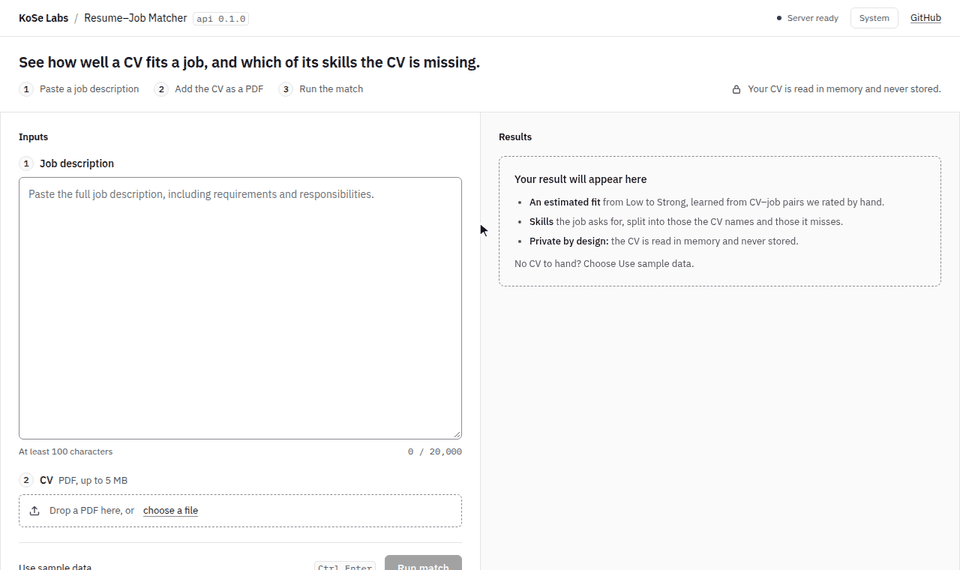
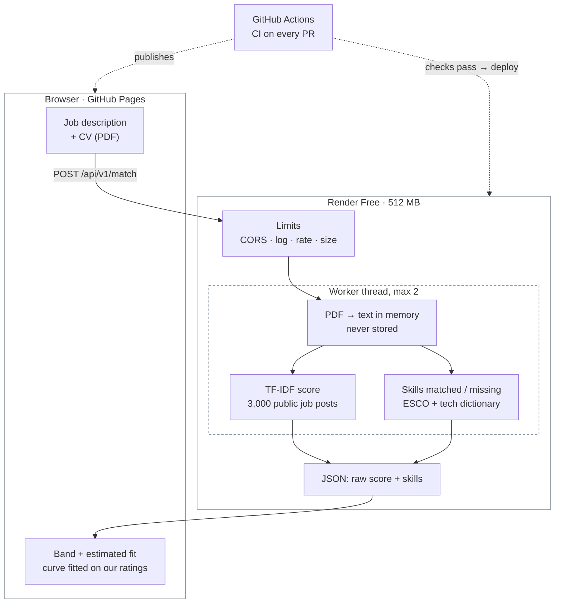

# Resume–Job Matcher

See how well a CV fits a job description, and why. CVs are processed in memory and never stored.

[](https://github.com/kose-labs/p1-resume-job-matcher/actions/workflows/ci.yml)
[](LICENSE)


## Demo

**Live:** https://kose-labs.github.io/p1-resume-job-matcher/ — click **Use sample data**, then
**Run match**. The backend sleeps after 15 idle minutes, so the first request can take about a
minute.



## Problem and solution

Screening CVs against a job description is slow, and keyword filters miss paraphrases while
rewarding keyword stuffing. Candidates get no explanation either way.

The matcher scores a CV against one job description and says it in plain language: a band
(Low / Moderate / Strong) and an estimated fit from 0 to 100%, learned from CV–job pairs we rated
by hand. It lists the job's skills that the CV names and the ones it misses. We measure it against
our own ratings of CV–job pairs, not against a feeling, and we publish the numbers and the limits
([evaluation](docs/evaluation.md), [model card](docs/model_card.md)).

## Features

- **PDF in, text out, in memory:** text-based PDFs up to 5 MB and 10 pages, including two-column
  layouts ([ADR-0003](docs/adr/0003-pdf-parser.md)). Scanned, encrypted or broken PDFs get a clear
  message.
- **A score you can read:** TF-IDF similarity fitted on 3,000 public job posts
  ([ADR-0006](docs/adr/0006-production-tfidf.md)), shown as a band and an estimated fit rounded to
  5%: how we'd likely rate the pair, from a curve fitted on our dev ratings. On held-out pairs it
  lands about 0.75 rating points from ours. The raw similarity stays visible, and the page says the
  fit isn't a probability of being hired.
- **Skills the job asks for:** split into those the CV names and those it misses, with a coverage
  line ("The CV names 7 of the job's 12 skills"). ESCO plus a tech dictionary
  (`app/ml/skills.py`): precision 0.904 and F1 0.715 on held-out job descriptions.
- **Made for comparing jobs:** Copy results puts a plain-text summary on the clipboard and Clear
  starts the next job, since the score is most useful across several jobs for one CV. CV sentences
  as evidence come in V1.1: no embedding model beat TF-IDF
  ([ADR-0004](docs/adr/0004-embedding-model.md)).
- **Privacy by design:** no database, no files, no CV or job text in logs, uploads never spooled to
  disk, Uvicorn's IP-recording access log off.
- **Safe to expose:** size and type checks while the upload arrives, a rate limit of 10 matches a
  minute per visitor, CPU work in a bounded thread pool so `/health` stays fast
  ([ADR-0005](docs/adr/0005-serving.md)).
- **Accessible interface:** light and dark themes, full keyboard support (Ctrl/Cmd + Enter runs a
  match), Lighthouse accessibility 100 on desktop and mobile, and no axe-core violations (WCAG 2.2
  AA) in any state or theme.

## Architecture



The full request path, components, capacity and configuration are in
[docs/architecture.md](docs/architecture.md). Decisions are recorded as ADRs in
[docs/adr/](docs/adr/).

## Tech stack

| Part | Tools |
|---|---|
| Backend | Python 3.12, FastAPI, pdfplumber, scikit-learn, uv |
| Frontend | React 19, TypeScript, Vite, CSS Modules with design tokens, IBM Plex (self-hosted) |
| Contract | OpenAPI → generated TypeScript types; CI fails if they drift |
| Quality | Ruff, mypy (strict), pytest; oxlint, Prettier, Vitest + Testing Library; pre-commit with gitleaks |
| Delivery | GitHub Actions (CI, dependency audit, Docker smoke and memory test), Render (backend), GitHub Pages (frontend) |

## Getting started

### Prerequisites
Python 3.12, [uv](https://docs.astral.sh/uv/), and Node 24 LTS (pinned in `frontend/.nvmrc`).
No Docker needed.

### Install and run locally
Backend, in one terminal:
```bash
cd backend
uv sync
uv run uvicorn app.main:app --reload
```
Frontend, in another:
```bash
cd frontend
npm ci
npm run dev
```
Open http://localhost:5173. The top bar should say **Server ready**; the Vite dev server forwards
`/api` to the backend, so no CORS setup is needed. API docs: http://localhost:8000/docs.

Once per clone, install the git hooks: `uvx pre-commit install`.

**Windows (PowerShell 5.1):** run the commands one per line (no `&&`). If `npm` says *"running
scripts is disabled"*, use `npm.cmd`. If `npm ci` fails with `EPERM … unlink`, close VS Code or the
dev server that has a file in `node_modules` open, then run it again.

### Environment variables
Copy `.env.example` to `.env` (never commit `.env`). None are needed locally.

| Variable | Where | Purpose |
|---|---|---|
| `CORS_ORIGINS` | backend | Frontend origins allowed to call the deployed API |
| `MATCH_CONCURRENCY` | backend | Matches that may use the CPU at once (default 2) |
| `TRUSTED_PROXY_HOPS` | backend | Proxies that append to `X-Forwarded-For`, so the rate limit sees each visitor's IP (`0` locally; see [deployment](docs/deployment.md)) |
| `VITE_API_URL` | frontend build | The deployed backend URL; empty locally |

### Running tests and checks
The same checks CI runs:

| | Backend (`cd backend`) | Frontend (`cd frontend`) |
|---|---|---|
| Lint | `uv run ruff check .` | `npm run lint` |
| Format | `uv run ruff format --check .` | `npm run format:check` |
| Types | `uv run mypy` | `npm run typecheck` |
| Tests + coverage (80% minimum) | `uv run pytest` | `npm run test:coverage` |
| Build | — | `npm run build` |

After changing the API, regenerate the frontend's contract and commit both files:
`npm run api:schema`, then `npm run api:types` (in `frontend/`).

## Usage

**In the browser:** paste a job description (at least 100 characters), drop a PDF CV or click
**Use sample data**, then **Run match**.

**From the command line**, with the fictional sample CV (`frontend/public/sample-cv.pdf`):
```bash
curl -F "cv=@frontend/public/sample-cv.pdf" -F "job_description=We need a backend engineer to build REST APIs in Python with FastAPI, PostgreSQL and Docker, deployed with CI/CD." https://p1-resume-job-matcher-api.onrender.com/api/v1/match
```
On Windows PowerShell, type `curl.exe` instead of `curl`. The response:
```json
{
  "score": 0.465,
  "skills": {
    "matched": [
      { "name": "Python", "esco_uri": "http://data.europa.eu/esco/skill/ccd0a1d9-afda-43d9-b901-96344886e14d" },
      { "name": "FastAPI", "esco_uri": null },
      { "name": "PostgreSQL", "esco_uri": "http://data.europa.eu/esco/skill/a8d07b5a-c1a1-42c6-9d53-db9c7a2ca996" },
      { "name": "Docker", "esco_uri": null }
    ],
    "missing": [{ "name": "REST API", "esco_uri": null }, { "name": "CI/CD", "esco_uri": null }]
  },
  "evidence": [],
  "model": { "name": "tfidf-baseline", "version": "0.1.0" },
  "warnings": ["uncalibrated_score"]
}
```
`score` is the raw TF-IDF similarity, hence `uncalibrated_score`. The page turns it into the band
and the estimated fit (`frontend/src/lib/scoreBands.ts`); this short, on-the-nose job description
reads as Strong fit, ≈ 100%. `evidence` stays empty until V1.1.
Errors come back as `{"detail": {"code": "...", "message": "..."}}` with 413 (too large),
415 (not a PDF), 422 (`pdf_no_text`, `pdf_unreadable`, `pdf_too_many_pages`, or invalid fields) or
429 (rate limited, with `Retry-After`). The full contract is at `/docs` on the API.

## Evaluation results

Our main metric is Spearman ρ between the score and our own ratings of 120 CV–job pairs, rated 1–5
by both of us under an [annotation protocol](research/annotation_protocol.md). Everything was chosen
on 40 dev pairs; the 80 test pairs (20 job descriptions) were run **once**, on the served model.
Full report: [evaluation](docs/evaluation.md) · [model card](docs/model_card.md).

| What (test set) | Result | Target |
|---|---|---|
| Agreement between our two raters | weighted κ **0.734** | ≥ 0.6 ✅ |
| **Score vs our ratings, served TF-IDF** | ρ **0.553** (95% CI 0.39 to 0.71) | ≥ 0.55 ✅ (just) |
| Score vs our ratings, K7 TF-IDF baseline | ρ 0.535 | reference |
| Best embedding model (MiniLM-L6, whole text) | ρ 0.529 | must beat TF-IDF by 0.10 ❌, so TF-IDF stays ([ADR-0004](docs/adr/0004-embedding-model.md)) |
| Estimated fit, error vs our ratings | 0.75 rating points (1.04 guessing the mean) | reference |
| Score band (Low / Moderate / Strong) right | 51 of 80 pairs (64%) | reference |
| Skill extraction (12 hand-labelled JDs) | precision **0.904**, recall 0.591, F1 **0.715** | precision ≥ 0.80 ✅, F1 ≥ 0.70 ✅ |
| Match latency, 2-page CV, warm server | 0.16 s | < 3 s ✅ |
| Peak memory, 4 concurrent 5 MB CVs | 192 MB | < 400 MB ✅ |

**What it means:** the score reliably flags poor matches and separates jobs from different fields,
which suits comparing several jobs for one CV. It is weak within one field (ρ 0.24 among same-field
pairs) and at recognising strong matches written in other words. The
[failure analysis](docs/evaluation.md#failure-analysis-the-10-largest-gaps-on-test) traces the
largest misses to generic process words, missing seniority signals and short CVs.

## Project structure

```
backend/
  app/              FastAPI app: limits, extraction, matching, logging, rate limit
    ml/             preprocessing, TF-IDF, embeddings, skills, metrics, artefacts
  scripts/          build the TF-IDF artefact, score the corpus, memory check, OpenAPI export
  tests/            pytest (synthetic PDFs built in memory)
  Dockerfile
frontend/
  src/              React app: components/, lib/, styles/ (tokens), api/ (generated types)
  public/           icon and the fictional sample CV
docs/               plan, ADRs, architecture, deployment, data and model cards, experiments
research/           annotation protocol, skill labelling guide, shared rating sheets
scripts/            corpus (K5), pair set and agreement (J2), parser comparison (S6)
data/               git-ignored: downloaded datasets, corpus, ratings in progress
render.yaml         Render Blueprint for the backend
```

## Roadmap

- **V1 (2026-10-18):** TF-IDF score shown as an estimated fit with bands, matched and missing
  skills, test-set results and failure analysis ([evaluation](docs/evaluation.md)), release
  `v0.2.0`.
- **Next (V2):** from the failure analysis, a seniority signal, skill coverage in the score,
  boilerplate removed before scoring, and synonyms for short forms ("DRF", "k8s"), all chosen on
  dev and checked on a fresh test set; then one CV against many jobs, DOCX and scanned CVs (OCR),
  languages other than English, and an LLM-based scorer measured the same way.

## Contributors and roles

- **Kobi Ampem Afriyie** ([@Kobi-Ampem](https://github.com/Kobi-Ampem)): ML lead and frontend lead.
  Data, rating protocol, evaluation and models; the web app's design and user experience for
  launch (intro, result card, skills coverage, copy results).
- **Semanu Kwaku Sebuava** ([@Ohm-Kel](https://github.com/Ohm-Kel)): engineering lead. API,
  security, deployment and CI, and the first version of the frontend.

Every change goes through a pull request reviewed by the other person, with green CI
([contributing guide](CONTRIBUTING.md)).

## License

[MIT](LICENSE) © 2026 KoSe Labs. ESCO data © European Union, reused under Commission Decision
2011/833/EU. The Djinni datasets are MIT-licensed (Drushchak and Romanyshyn, 2024).
