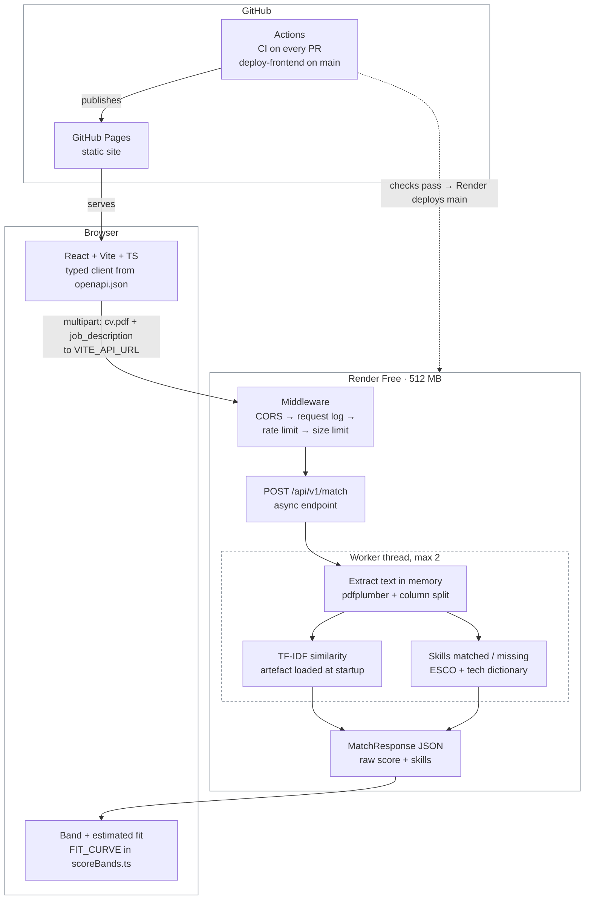

# Architecture: P1 Resume–Job Matcher

**Status:** 2026-10-18, describes `v0.2.0` (the V1 launch). Owner: Semanu (eng lead). Decisions
live in `docs/adr/`.

## In one paragraph
A static React site on **GitHub Pages** sends a CV (PDF) and a job description to a **FastAPI**
service in one Docker container on **Render Free** (0.1 CPU, 512 MB). The service checks the upload,
reads the PDF's text in memory, scores it with TF-IDF and splits the job's skills into matched and
missing. The browser turns the raw score into a band and an estimated fit. CV sentences as evidence
come in V1.1 (#78). Nothing is stored: no database, no files, no CV text in logs. Everything is
built, tested and deployed from GitHub on every merge to `main`.

## System diagram

## A match request, step by step

| Step | Where | Rejects with |
|---|---|---|
| 1. Browser checks file type, 5 MB and the 100-character minimum before sending | `frontend/src/App.tsx` | (inline message, nothing sent) |
| 2. CORS adds headers to every answer, errors included | `CORSMiddleware` (outermost) | browser blocks other origins |
| 3. Request gets an ID; its outcome is logged at the end | `RequestLog` (`app/observability.py`) | — |
| 4. Client over 10 matches a minute is turned away **before the upload is read** | `RateLimit` (`app/ratelimit.py`) | **429** + `Retry-After` |
| 5. Body over 5 MB + 128 KB is cut off **while it arrives**, even without `Content-Length` | `BodySizeLimit` (`app/limits.py`) | **413** |
| 6. Fields validated: job description 100–20,000 characters after trimming | FastAPI + Pydantic | **422** (field list) |
| 7. CV read in memory (never spooled to disk); must start with `%PDF-` | `read_cv` (`app/limits.py`) | **413**, **415** |
| 8. Text extracted, two-column pages read column by column | `extract` (`app/extract.py`, ADR-0003) | **422** `pdf_unreadable`, `pdf_too_many_pages`, `pdf_no_text` |
| 9. Text scored against the job description | `MatchService` (`app/matching.py`) | — |
| 10. Response built from the contract's models; a `match` log line is written | `app/schemas.py`, `app/main.py` | — |

Steps 8–9 run together in a worker thread, at most `MATCH_CONCURRENCY` (2) at once (ADR-0005), so
the event loop stays free for `/health` and other requests.

**Middleware order matters.** Starlette runs the last-added middleware first. CORS is added last so
that the 413 and 429 answers produced by the limits also carry CORS headers; otherwise the browser
would hide them and the page could only say "couldn't reach the server".

## Components

| Part | Code | Responsibility | Decision |
|---|---|---|---|
| Frontend | `frontend/src/App.tsx`, `src/components/`, `src/api/client.ts` | Two-pane workspace: inputs, results report (score band, skills, evidence), wake-up state for cold starts, errors with next steps, 60 s timeout, themes from design tokens | ADR-0002 |
| API contract | `backend/app/schemas.py` → `frontend/openapi.json` → `src/api/schema.d.ts` | One source of truth; CI fails if the generated files drift | — |
| Limits | `app/limits.py`, `app/ratelimit.py` | Size, type, rate; client IP counted from the right of `X-Forwarded-For` (`TRUSTED_PROXY_HOPS`) | — |
| PDF extraction | `app/extract.py` | pdfplumber, column split (gap needs text on both sides), scanned/encrypted/page checks | ADR-0003 |
| Preprocessing | `app/ml/preprocess.py` | Cleanup, sections, sentences, tech-aware tokens (C++, C#, .NET, Go) | plan (K6) |
| Matchers | `app/ml/tfidf.py`, `app/ml/embeddings.py` (#40) | TF-IDF (served); the embedding matcher stays for V1.1 (none beat TF-IDF) | ADR-0006, ADR-0004 |
| Skills | `app/ml/skills.py` | ESCO + tech dictionary, longest match; splits the job's skills into matched and missing | K9 |
| Match service | `app/matching.py` | Built once at startup (lifespan), injected with `Depends`; TF-IDF from the committed artefact, scores flagged `uncalibrated_score` | ADR-0005, ADR-0006 |
| Logging | `app/observability.py` | JSON lines: request ID, method, path, status, duration, CV size, pages, outcome code | plan (privacy) |
| Evaluation | `backend/app/ml/metrics.py`, `scripts/j2-pairs/` | Weighted κ, Spearman ρ with JD-level bootstrap | protocol |

## Data and privacy
- **No storage.** CV bytes and text exist only in memory for one request. No database, no files.
  Uploads are kept in memory by raising Starlette's spool threshold above the request limit.
- **Logs:** only the fields above; a test fails if CV or job text reaches any log line, or if a log
  line gains a field outside the allowed set. Uvicorn's access log is off (it records IPs).
- **Evaluation data** (Djinni corpus, ratings) lives in git-ignored `data/` on our machines; the repo
  holds only the scripts and pinned dataset revisions (ADR-0001).
- **Production model:** no CV-derived artefacts in the image. TF-IDF is fitted on 3,000 public job
  descriptions only (evaluation set excluded) and committed as a 238 KB gzipped-JSON artefact that
  `scripts/build_tfidf_artifact.py` rebuilds byte for byte (ADR-0006).

## Capacity and memory
- One process, one Uvicorn worker; CPU work capped at 2 concurrent matches (ADR-0005).
- **Measured in CI** on every PR: four near-5 MB, 10-page CVs at once against the image capped at
  512 MB: **peak 192 MB** with the TF-IDF model loaded (it adds about 8 MB and loads in about
  150 ms). Budget 400 MB, leaving about 200 MB for an embedding model.
- Render Free sleeps after 15 idle minutes; the frontend shows "Waking up the server…" until
  `/api/v1/version` answers.

## Build, test and deploy

| Workflow | Runs | What it checks or does |
|---|---|---|
| `ci.yml` → `pre-commit` | every PR and push to `main` | Ruff, gitleaks secret scan, file hygiene |
| `ci.yml` → `backend` | " | Ruff, mypy (strict), pytest with coverage (80% minimum), dependency audit, OpenAPI drift |
| `ci.yml` → `frontend` | " | oxlint, Prettier, `tsc`, Vitest with coverage, dependency audit, generated-types drift, build |
| `ci.yml` → `docker` | " | Builds the image, `/health` smoke test, memory under load at 512 MB |
| `deploy-frontend.yml` | merge to `main` touching `frontend/` | Builds with `VITE_API_URL` and the repo base path, publishes to Pages |
| Render (`render.yaml`) | merge to `main` once CI passes | Builds `backend/Dockerfile`, health check `/health` |

`main` is protected: pull request with one approval (dismissed by a new push), all four CI jobs
green, squash merge only, no force pushes. Branches don't have to be up to date with `main` before
merging; we dropped that rule on 2026-10-17 because every merge reset the other open PRs.

## Configuration

| Variable | Where | Default | Purpose |
|---|---|---|---|
| `CORS_ORIGINS` | Render | — | Allowed frontend origin (`https://kose-labs.github.io`) |
| `TRUSTED_PROXY_HOPS` | Render | `0` (Render: start at `1`) | Proxies appending to `X-Forwarded-For`, for the per-client rate limit |
| `MATCH_CONCURRENCY` | Render | `2` | Matches using the CPU at once |
| `PORT` | set by Render | `10000` | Port the container listens on |
| `VITE_API_URL` | GitHub repo variable | — | Backend URL baked into the frontend build |

## Decisions
| ADR | Decision | Status |
|---|---|---|
| 0001 | Data: Djinni corpus for evaluation; Kaggle PDFs local only | accepted (2026-10-12) |
| 0002 | Stack and free-tier hosting: GitHub Pages + Render Free | accepted (2026-10-12) |
| 0003 | PDF text: pdfplumber + column split | accepted (2026-10-18), without the real-CV rerun (#98) |
| 0004 | Embedding model: none beat TF-IDF on our dev ratings, so TF-IDF stays | accepted (2026-10-17) |
| 0005 | Serving: async endpoint, CPU work in threads, max 2 at once, load once | accepted (2026-10-18) |
| 0006 | Production TF-IDF fitted on public job descriptions, committed as a JSON artefact | accepted (2026-10-18) |

## Known limits
- Text-based PDFs only; scanned CVs are rejected rather than OCR'd (V2).
- Two-column CVs are split into columns; three columns, tables and text boxes haven't been checked
  on real CVs (ADR-0003, #98).
- Per-client rate limiting depends on the right `TRUSTED_PROXY_HOPS` (see `docs/deployment.md`).
- One instance: a restart resets rate-limit counters; a cold start takes about a minute.
- Evaluation covers IT jobs from one market (ADR-0001); the model card states the limits.
