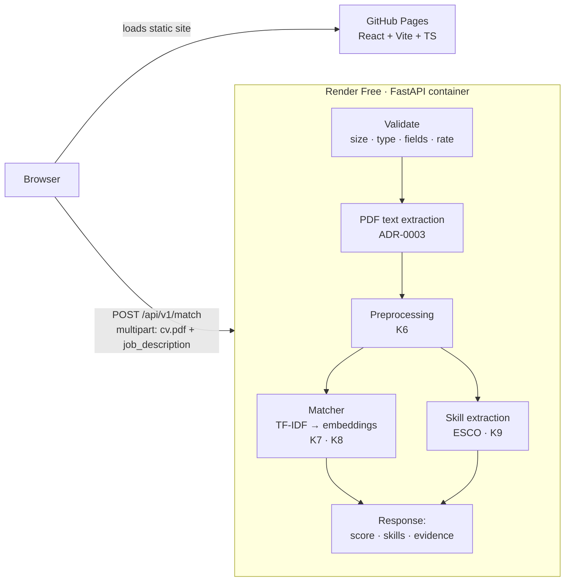

# P1: Resume–Job Matcher, Project Plan

**Size:** minor (≤10 d) · **Dates:** 2026-10-09 → 2026-10-18
**ML lead:** Kobi · **Eng lead:** Semanu · **Security:** Semanu

## Problem (2–3 sentences)
Students and early-career engineers send dozens of applications without knowing how well their CV
actually fits each job, or which missing skills cost them the interview. Keyword-based screening
tools give a number with no explanation. P1 scores a CV against one job description, shows the
required skills it covers and misses, and points to the CV sentences behind the score, so the
candidate knows what to fix.

**Users:** job seekers tailoring a CV to a posting (primary); recruiters skimming a first fit
(secondary, demo only, not for hiring decisions).

## Demo (what a recruiter sees in 30 s)
Paste a job description, upload a CV as a PDF, press **Match**. Within a few seconds the page shows a
match score, the skills the CV covers and misses, and the CV sentences that back up the score.
The CV is processed in memory and never stored.

## Scope (frozen on day 1)
**In V1** (engineering and ML):
- One page: JD text box + CV PDF upload → score, skills (matched / missing), evidence.
- `POST /api/v1/match` as specified below, with validation, size limit and rate limit.
- Text-based PDFs only (one or two columns); scanned PDFs rejected with a clear message.
- Deployed: frontend on GitHub Pages, backend on Render Free (ADR-0002).
- Matcher: TF-IDF baseline, then sentence embeddings over JD requirements × CV sentences; the
  better one on the test set ships (ADR-0004).
- Skill extraction from both texts with ESCO plus our own tech dictionary; matched / missing lists.
- Evaluation on our own rated pairs (annotation protocol), reported in the model card with the
  baseline next to it.

**Out (→ V2 issues):**
- DOCX and image (OCR) CVs.
- Accounts, history or saving results.
- Matching one CV against many jobs (or the reverse).
- Languages other than English.
- Fine-tuning or training our own model (V1 uses pretrained models only).
- LLM-generated advice ("rewrite this bullet") and scoring with an LLM.
- Weighting years of experience, education or location.

## Data
Details and alternatives in **ADR-0001**.
- **Evaluation corpus (K5):** 30 English JDs and 30 English CVs from the Djinni Recruitment Dataset
  (MIT, anonymized, IT jobs 2020–2023), 5 of each from six fields (Python, Data Science, JavaScript,
  Java, DevOps, QA). Built by one script from pinned dataset revisions; stored in `data/`
  (git-ignored), never committed.
- **Labels:** 120 CV–JD pairs rated 1–5 by both of us, following `research/annotation_protocol.md`.
  Final label = mean of the two ratings. Split by JD: 10 JDs dev, 20 JDs test.
- **Skill extraction labels (K9):** required skills hand-marked in 20 JDs (dev 8 / test 12).
- **Skill vocabulary:** ESCO skills (EU taxonomy) plus a small tech dictionary we maintain
  (C++, C#, Node.js, FastAPI… which ESCO names differently or lacks).
- **PDF checks:** a few local-only PDFs from the Kaggle Resume Dataset and Semanu's synthetic fixtures.

## Approach
Five steps; each matcher is measured against the previous one on the same pairs:

1. **Preprocessing (K6).** Clean PDF artefacts (hyphenation at line breaks, bullets, ligatures),
   protect tech tokens that naive tokenizers break (`C++`, `C#`, `.NET`, `Node.js`), split into
   sections and sentences. Shared by every model, so differences come from the model only.
2. **Baseline: TF-IDF + cosine similarity (K7).** Word 1–2-grams, vectorizer fitted once on the whole
   corpus (not per pair), so IDF reflects how rare a term is across jobs and CVs. Cheap, explainable,
   and the number every later model has to beat.
3. **Sentence embeddings with chunking (K8).** Split the JD into requirement sentences and the CV
   into sentences; embed both with a small pretrained model that fits in 512 MB (ONNX or static
   embeddings, ADR-0004). For each requirement, take the best-matching CV sentence; the score is the
   weighted mean of those best similarities, and the top pairs become the **evidence** list.
   Catches paraphrases TF-IDF misses ("built REST services" vs "API development").
4. **Skill extraction (K9).** Match ESCO skill labels and our dictionary in both texts (exact and
   normalized forms). JD skills found in the CV → `matched`, the rest → `missing`.
5. **Final score:** a weighted mix of the semantic score and skill coverage, weights tuned on dev only.

**Why not an LLM or fine-tuning in V1:** 10 days, 512 MB RAM, and we want a score we can explain
and evaluate. An LLM scorer is a V2 experiment against the same test set.

## Evaluation
All ML numbers are on the **test** split (20 JDs, ~80 pairs), computed once per model version.

| What | Metric | Target for V1 |
|---|---|---|
| **Match score** (main) | Spearman ρ between system score and our mean rating | **ρ ≥ 0.55** for the shipped model, and **≥ 0.10 above the TF-IDF baseline**, with a 95% bootstrap CI of the difference (resampling JDs) above 0 |
| Baseline | Same metric for TF-IDF (K7) | Reported, no target: it's the reference |
| Ceiling | Agreement between the two of us: quadratic weighted Cohen's κ | **κ ≥ 0.6** on the calibration batch (protocol). The model can't be judged more precisely than we agree |
| **Skill extraction** | Precision, recall, micro F1 of JD skills vs hand labels | **F1 ≥ 0.70, precision ≥ 0.80** (a wrong "missing skill" misleads the user more than a skipped one) |
| Evidence | Share of top-3 evidence pairs we judge relevant, on 10 test pairs | **≥ 2 of 3** on average |

**Failure analysis:** the 10 pairs with the largest gap between score and rating get a written
explanation in the model card (e.g. synonyms, short profiles, keyword stuffing).


Engineering targets:
- `/api/v1/match` answers in **under 3 s** for a 2-page CV on a warm Render Free instance.
- Peak memory of the running API stays **under 400 MB** (Render Free gives 512 MB).
- `/health` answers in under 200 ms even while `/match` requests are running.

## Architecture (sketch)



- **Stateless:** no database and no file storage. Each request is handled entirely in memory.
- **Model loaded once** at startup through FastAPI's lifespan and injected with `Depends` (S9), so
  requests don't pay the loading cost and tests can swap in a fake model.
- **Deployment:** GitHub Actions publishes the frontend to GitHub Pages on every merge to `main`.
  Render builds `backend/Dockerfile` on every merge to `main`. The frontend reads the backend URL from
  `VITE_API_URL`; the backend only accepts the Pages origin through `CORS_ORIGINS`.
- **Cold starts:** Render Free sleeps after 15 minutes idle and takes about a minute to wake. The
  frontend calls `/health` when the page opens and shows "Waking up the server…" until it answers.

## API contract (draft v1)

Interactive docs at `/docs`; the TypeScript client is generated from `/openapi.json` (S8).

### `POST /api/v1/match`

**Request:** `multipart/form-data`
| Field | Type | Rules |
|---|---|---|
| `cv` | file | PDF only, checked by its first bytes (`%PDF-`), not by file name or browser-sent type. At most **5 MB** and **10 pages**. Must contain extractable text. |
| `job_description` | text | **100 to 20,000 characters** after trimming whitespace. |

**Response `200 OK`:** `application/json`
```json
{
  "score": 0.72,
  "skills": {
    "matched": [{ "name": "Python", "esco_uri": "http://data.europa.eu/esco/skill/…" }],
    "missing": [{ "name": "Kubernetes", "esco_uri": null }]
  },
  "evidence": [
    {
      "requirement": "3+ years building REST APIs in Python",
      "cv_excerpt": "Built and maintained FastAPI services handling 2k requests/min",
      "similarity": 0.81
    }
  ],
  "model": { "name": "tfidf-baseline", "version": "0.1.0" },
  "warnings": ["job_description_truncated"]
}
```
| Field | Meaning |
|---|---|
| `score` | Overall match, a float from 0 to 1, rounded to 2 decimals. |
| `skills.matched` / `skills.missing` | Skills from the JD found / not found in the CV. `esco_uri` is `null` when the skill comes from our own tech dictionary instead of ESCO. |
| `evidence` | Up to 5 pairs of (JD requirement, CV sentence) that contributed most to the score, best first. |
| `model` | Which matcher produced the result, so results stay explainable as the model changes. |
| `warnings` | Non-fatal notes, e.g. `job_description_truncated`, `cv_text_short`. Empty list when none. |

### Errors

Our own errors use one shape, so the frontend can show a message and branch on `code`:
```json
{ "detail": { "code": "file_too_large", "message": "The CV must be 5 MB or smaller." } }
```
Validation errors from FastAPI (422 with a list of field problems) keep FastAPI's standard shape,
which the generated client already understands.

| Status | `code` | When |
|---|---|---|
| **413** Content Too Large | `file_too_large` | `cv` is over 5 MB. Enforced while reading the upload, not only from the `Content-Length` header. |
| **415** Unsupported Media Type | `unsupported_file_type` | `cv` doesn't start with `%PDF-`. |
| **422** Unprocessable Content | *(FastAPI list)* | A field is missing, or `job_description` is too short or too long. |
| **422** | `pdf_unreadable` | Corrupted or password-protected PDF. |
| **422** | `pdf_no_text` | No extractable text (a scanned or image-only PDF). Message suggests exporting the CV as a text PDF. |
| **422** | `pdf_too_many_pages` | More than 10 pages. |
| **429** Too Many Requests | `rate_limited` | More than **10 requests per minute** from one IP. Includes a `Retry-After` header. |
| **500** | `internal_error` | Anything unexpected. The message never contains CV text. |

### `GET /health`
`200 {"status": "ok"}`. No model work, so it stays fast for health checks and the wake-up call.

## Security & privacy
- **Never store or log CVs.** CV bytes and extracted text live only in memory for the length of
  one request. They are never written to disk, a database, logs, error messages or analytics.
- Logs record only: request ID, status code, duration, file size and page count.
- Uploads are limited (5 MB, 10 pages) and rate-limited (10/min per IP) to stop abuse of a free server.
- File type is checked by content (magic bytes), never trusted from the file name.
- CORS allows only the GitHub Pages origin. No cookies or accounts, so no session data to protect.
- Secrets live in GitHub and Render settings, never in git. gitleaks runs in pre-commit and CI;
  Dependabot and GitHub secret scanning with push protection are on.
- Test fixtures are synthetic PDFs only. Real CVs used for evaluation stay in `data/` (git-ignored)
  on our own machines.

## Risks & fallbacks
| Risk | Likelihood | Fallback |
|---|---|---|
| Model doesn't fit in Render Free's 512 MB | Medium | ONNX-based embeddings (fastembed) or static embeddings (model2vec) instead of PyTorch; TF-IDF baseline always fits |
| Cold start (≈1 min) looks broken to a visitor | High | "Waking up the server…" state; wake the API when the page loads |
| Two-column CVs extracted in the wrong reading order | Medium | Parser chosen on two-column samples (ADR-0003); fall back to layout-aware extraction |
| Abuse of the public endpoint (large files, floods) | Low | Size, page and rate limits above |
| CV text leaking through logs or errors | Low | Logging policy above, plus a test that a CV's text never appears in log output |
| Render Free limits change or the service is suspended | Low | Same Dockerfile runs on another free host; frontend only needs a new `VITE_API_URL` |
| Embeddings don't beat TF-IDF on our pairs | Medium | Ship the better model and report both honestly; try requirement-level chunking and skill-coverage weighting before switching models |
| Our ratings disagree too much (κ < 0.6) | Medium | Sharpen the anchors and rate a second calibration batch; report κ next to ρ |
| Too few rated pairs for a stable ρ | Medium | Bootstrap CIs on every number; rate more pairs from dev only if time allows |
| Djinni profiles are shorter than real CVs, so results don't transfer | Medium | Say so in the data and model cards; spot-check on local PDF CVs |
| ESCO misses or misnames tech skills | High | Our own tech dictionary on top of ESCO; F1 measured per source |
| Bias: scores track protected attributes inferable from text | Low–Medium | Skills/experience text only, no demographic features; documented as a limitation and a research note |

## Milestones
| Day | Milestone | Owner |
|---|---|---|
| 1 (10-09) | Plan, ADR-0001/0002, repo scaffold with CI green, security baseline, kickoff posts | Both |
| 2 (10-10) | Evaluation corpus collected; PDF parser chosen (ADR-0003) | Kobi · Semanu |
| 3 (10-11) | TF-IDF baseline scores; `/api/v1/match` skeleton with validation | Kobi · Semanu |
| 4 (10-12) | Embeddings (ADR-0004); frontend upload form via generated client | Kobi · Semanu |
| 5 (10-13) | Skill extraction with F1; model lifecycle and concurrency; mid-project check | Both |
| 6–10 | *Set at the mid-project check* | Both |
| 10 (10-18) | Launch: Definition of Done met, deployed, launch posts | Both |

## Learning goals
**Semanu (engineering):** validating uploads safely (magic bytes, streaming size limits), designing
a stable API contract and generating a typed client from it, model lifecycle and `def` vs `async`
in FastAPI, rate limiting, CORS, and privacy-by-design for personal data.

**Kobi (ML):** text preprocessing for noisy documents, TF-IDF and cosine similarity (and why the
vectorizer is fitted once on the corpus), sentence embeddings and chunking strategies, choosing a
model under a memory budget, building an evaluation set (annotation protocol, inter-rater agreement
with weighted κ, dev/test leakage), rank correlation and bootstrap confidence intervals, precision /
recall / F1 for extraction, and honest failure analysis.
